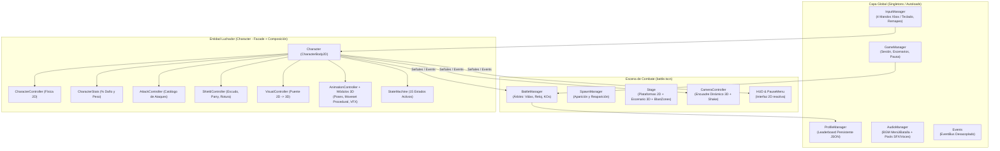
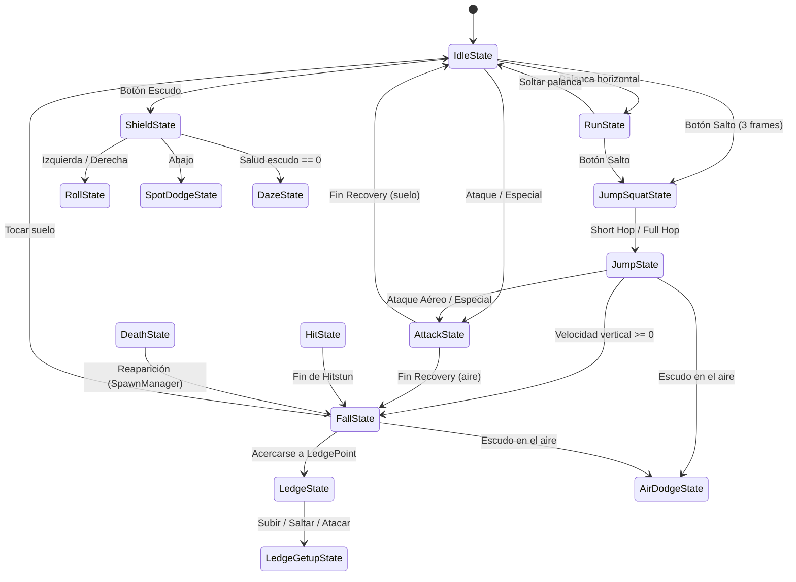
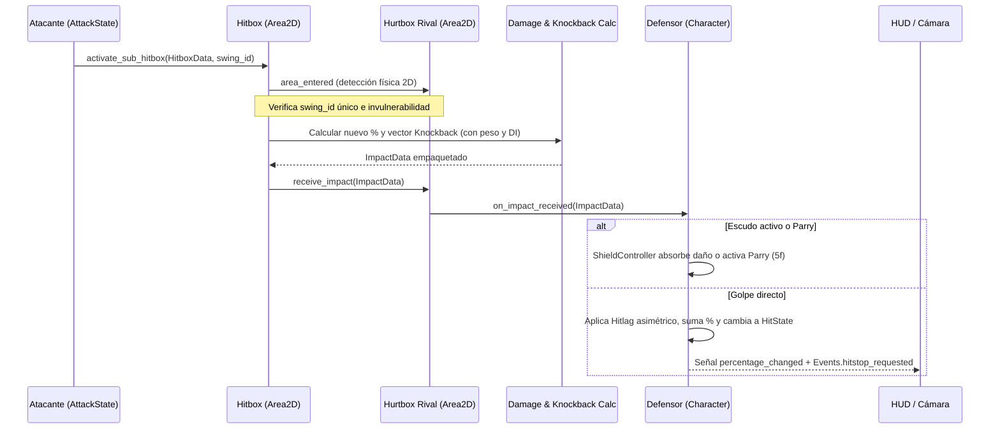

# Arquitectura Técnica — Smash en Casa (Godot 4.7)

Documento técnico de referencia que describe la estructura real, los módulos, las decisiones de diseño y el flujo de datos del proyecto **Smash en Casa**.

---

## 1. Visión General: Arquitectura Híbrida 2.5D

Uno de los pilares más importantes del motor de combate es su **arquitectura híbrida 2.5D**:

1. **Simulación Física y Colisiones en 2D (60 FPS fijos)**:
   - Todos los luchadores (`Character` hereda de `CharacterBody2D`), proyectiles (`Projectile`), cajas de golpe (`Hitbox`), cajas vulnerables (`Hurtbox`), empujes de cuerpo (`Pushbox`) y plataformas del escenario usan el motor físico **2D** de Godot.
   - Esto garantiza colisiones exactas en un único plano lateral, sin errores de profundidad en el eje `Z`.
2. **Representación Visual, Esqueletos y Cámara en 3D**:
   - Cada luchador crea un rig visual 3D (`VisualController` -> `Node3D` -> `Skeleton3D` / `AnimationPlayer`) sincronizado cuadro a cuadro con su posición física 2D mediante `Utils.pos_2d_to_3d()` (`100 píxeles 2D = 1.0 metro 3D`, definido en `Constants.PIXEL_TO_METER`).
   - La cámara (`CameraController` sobre `Camera3D`) encuadra dinámicamente en 3D a los 2–4 luchadores activos.



---

## 2. Mapa Completo de Directorios y Clases

```text
smash-en-casa/
├── core/                           # Autoloads globales y estructuras base de sesión
│   ├── events.gd                   # EventBus global de señales de combate y efectos
│   ├── game_manager.gd             # Estado de sesión (P1..P4, escenarios, pausa, ganador)
│   ├── input_manager.gd            # Mapeo estilo Yuzu (4 jugadores), lectura de ejes/botones y JSON
│   ├── player_input.gd             # DTO con la intención instantánea de control de un frame
│   ├── audio_manager.gd            # BGM con crossfade y pools de canales SFX / Voces
│   └── profile_manager.gd          # Persistencia de victorias, derrotas y Win Rate por perfil
│
├── shared/                         # Constantes físicas y utilidades matemáticas puras
│   ├── constants.gd                # Conversión 2D<->3D, gravedad, hitlag, capas de colisión
│   └── utils.gd                    # Conversión de vectores, formato de % / reloj y curvas
│
├── resources/                      # Diseño Orientado a Datos (Scriptable Objects / .tres)
│   ├── character_data.gd           # Ficha técnica del luchador (stats, modelo 3D, escala, moveset)
│   ├── moveset.gd                  # Diccionario tipado de los 13 ataques de un personaje
│   ├── attack_data.gd              # Datos puros de un ataque (frames, daño, ángulo, hitboxes)
│   └── instances/                  # Archivos .tres de Batman, Sakuya, Gogeta, Miyabi, Hornet, Sans, John
│
├── physics/                        # Fórmulas físicas puras sin estado
│   └── knockback_calculator.gd     # Fórmula estilo Smash Bros + Directional Influence (DI)
│
├── systems/                        # Sistemas transversales de jugabilidad
│   ├── input_buffer.gd             # Cola temporal de entradas (8 frames) para fluidez competitiva
│   └── camera_controller.gd        # Seguimiento 3D multi-objetivo, zoom dinámico y screen shake
│
├── combat/                         # Motor de colisiones ofensivas y defensivas 2D
│   ├── hitbox_data.gd              # Geometría y propiedades de una caja de daño individual
│   ├── hitbox.gd                   # Area2D ofensiva; agrupa swings para no golpear 2 veces
│   ├── hurtbox.gd                  # Area2D defensiva; gestiona invulnerabilidad e impactos
│   ├── pushbox.gd                  # Empuje suave horizontal entre personajes en el suelo
│   ├── damage_calculator.gd        # Suma de daño acumulado con límite 0% - 999%
│   ├── impact_data.gd              # Paquete inmutable de datos de un impacto confirmado
│   └── projectile.gd               # Clase base física 2D + visual 3D para proyectiles
│
├── characters/                     # Arquitectura modular del luchador (Facade + FSM)
│   ├── character.tscn / .gd        # Nodo raíz (Facade) que coordina todos sus subcomponentes
│   ├── character_controller.gd     # Movimiento horizontal, gravedad, fast-fall y saltos
│   ├── character_stats.gd          # Estado de daño (%) y peso del luchador
│   ├── attack_controller.gd        # Resolución direccional del ataque normal o especial a usar
│   ├── shield_controller.gd        # Salud del escudo, drenaje, regeneración, Parry y Shield Break
│   ├── visual_controller.gd        # Instanciación del GLB 3D, espejado suave y puente 2D->3D
│   ├── animation_controller.gd     # Coordinador de animaciones del luchador
│   ├── procedural_pose_solver.gd   # Cinemática procedural sobre huesos de Skeleton3D
│   ├── procedural_moveset_builder.gd # Generador de bibliotecas de animación de respaldo
│   ├── combat_vfx_controller.gd    # Estelas de golpes, flashes de daño, humo y ondas de choque
│   ├── hornet/                     # Proyectiles exclusivos de Hornet (SpikeBall, Weaverling)
│   ├── sans/                       # Proyectiles exclusivos de Sans (Bone, GasterBlaster)
│   └── state_machine/              # Máquina de Estados Finita (15 estados activos)
│       ├── state_machine.gd        # Gestor de transiciones y alias de estados
│       ├── state.gd                # Clase base abstracta de todos los estados
│       ├── idle_state.gd           # Reposo en suelo
│       ├── run_state.gd            # Carrera continua
│       ├── jumpsquat_state.gd      # Pre-salto de 3 frames (decide Short Hop vs Full Hop)
│       ├── jump_state.gd           # Ascenso aéreo y doble salto
│       ├── fall_state.gd           # Caída libre y Fast-Fall
│       ├── attack_state.gd         # Ejecución por fases (Startup -> Active -> Recovery + FAF)
│       ├── hit_state.gd            # Aturdimiento por golpe (Hitstun) y estelas de lanzamiento
│       ├── shield_state.gd         # Guardia activa y opciones Out-Of-Shield (OOS)
│       ├── roll_state.gd           # Rodada evasiva con invulnerabilidad
│       ├── spotdodge_state.gd      # Esquive en el sitio
│       ├── air_dodge_state.gd      # Esquive aéreo direccional o neutro
│       ├── daze_state.gd           # Mareo tras rotura de escudo (mashing para despertar antes)
│       ├── ledge_state.gd          # Agarre al borde de la plataforma
│       ├── ledge_getup_state.gd    # Subida normal, salto o ataque desde el borde
│       └── death_state.gd          # Estado bloqueado tras cruzar la BlastZone hasta reaparecer
│
├── battle/                         # Reglas de partida y escenarios
│   ├── battle.tscn / .gd           # Orquestador que conecta Escenario, Jugadores, Cámara y HUD
│   ├── battle_manager.gd           # Árbitro de vidas (stocks), reloj, KOs, TimeStop y ganador
│   ├── spawn_manager.gd            # Instanciación de 2 a 4 luchadores y reaparición aérea
│   ├── stage.gd                    # Inicialización de plataformas 2D one-way y BlastZones
│   └── ledge_point.gd              # Punto de agarre de borde detectado por luchadores en caída
│
├── effects/                        # Efectos visuales globales de combate
│   ├── death_streak_vfx.gd         # Rayo explosivo estilo Smash al cruzar la BlastZone
│   └── time_stop_overlay.gd        # Inversión cromática en pantalla para "El Mundo" de Sakuya
│
└── ui/                             # Pantallas de menú, configuración, HUD y resultados
    ├── ui_theme_utils.gd           # Utilidades compartidas: StyleBox, sintetizador WAV y Markdown
    ├── main_menu.gd                # Menú principal 3D con carrusel de personajes en vivo
    ├── character_select.gd         # Selección multijugador (2–4P), cursores 3D y escenarios
    ├── character_select_3d_builder.gd # Constructor de cartas 3D, retratos SubViewport y pedestales
    ├── controls_config.gd          # Configuración estilo Yuzu para 4 controles Xbox / Teclado
    ├── settings_panels_builder.gd  # Constructor modular de pestañas de Audio y Créditos
    ├── xbox_controller_view.gd     # Dibujo vectorial en vivo del mando Xbox y zona muerta
    ├── leaderboard.gd              # Tabla de clasificación histórica por perfiles
    ├── hud.gd                      # Porcentajes, vidas, medidores de Sakuya/Hornet y reloj
    ├── pause.gd                    # Menú modal de pausa durante el combate
    └── victory.gd                  # Pantalla de campeón post-partida
```

---

## 3. Arquitectura Orientada a Datos (Data-Driven Characters)

Un personaje jugable **no requiere crear una subclase nueva de `Character`**. Todos los luchadores comparten exactamente la misma escena `character.tscn` y el mismo script `character.gd`. Lo que diferencia a **Lego Batman**, **Sakuya**, **Gogeta**, **Miyabi**, **Hornet** o **Sans** son sus archivos de recursos `.tres`:

```text
CharacterData (.tres)
 ├── Atributos físicos: weight, run_speed, air_speed, jump_force, gravity_scale
 ├── Apariencia 3D: model_scene (.glb), model_scale, model_offset, animation_library
 └── MoveSet (.tres)
      ├── Ataques en suelo: neutral, side_tilt, up_tilt, down_tilt
      ├── Ataques aéreos: neutral_air, forward_air, back_air, up_air, down_air
      └── Especiales: neutral_special, side_special, up_special, down_special
           └── AttackData (.tres)
                ├── Tiempos en frames (60 FPS): startup_frames, active_frames, recovery_frames, faf
                ├── Propiedades de impacto: damage, base_knockback, knockback_scaling, angle
                └── Cajas de colisión: Array[HitboxData] o escena de proyectil
```

**Ventaja clave**: `AttackData` contiene **únicamente datos** (cuánto dura y cuánto pega), mientras que `AttackState` contiene **únicamente comportamiento** (avanzar frames, encender/apagar `Hitbox` y permitir cancelaciones IASA/FAF).

---

## 4. Máquina de Estados Finita (FSM) del Luchador

Cada personaje posee un nodo `StateMachine` cuyos hijos heredan de `State`. Solo **un estado** está activo a la vez, evitando combinaciones inválidas de banderas booleanas (por ejemplo, atacar mientras está mareado o bloqueando).



---

## 5. Flujo Completo de un Impacto en Combate



---

## 6. Ciclo de Vida de una Partida y Leaderboard

1. **`MainMenu`**: Inicializa la música de menú (`AudioManager.play_menu_theme()`) y muestra el carrusel 3D. Permite abrir `ControlsConfig` (hasta 4 controles Xbox/Teclado y perfiles personalizados) o `LeaderboardUI`.
2. **`CharacterSelect`**: Soporta de **2 a 4 jugadores**. Cada jugador navega el abanico 3D con su dispositivo configurado en `InputManager`, elige personaje (o `?` Aleatorio) y escenario (`Santuario Astral`, `Cámara Cibernética` o `Caldera Ardiente`), y transfiere la sesión a `GameManager.start_match_multi(...)`.
3. **`BattleScene` + `BattleManager`**:
   - `SpawnManager` instancia únicamente los luchadores activos (`active_player_ids`).
   - Cuando un jugador cruza una `BlastZone` del `Stage`, `BattleManager` descuenta una vida (`stock`), dispara `DeathStreakVFX` y ordena reaparecer con invulnerabilidad temporal si aún le quedan vidas.
   - Cuando solo queda un jugador en pie (o se agota el tiempo y se resuelve por vidas y menor porcentaje de daño), `BattleManager` invoca **una única vez** `GameManager.end_match(winner_id)`.
4. **`ProfileManager` + `VictoryMenu`**:
   - `GameManager.end_match()` notifica a `ProfileManager.record_match_result()`, guardando en `user://leaderboard.json` la victoria del perfil campeón, las derrotas de los demás participantes y el personaje utilizado.
   - Finalmente carga `victory.tscn` mostrando al campeón y su emblema.
