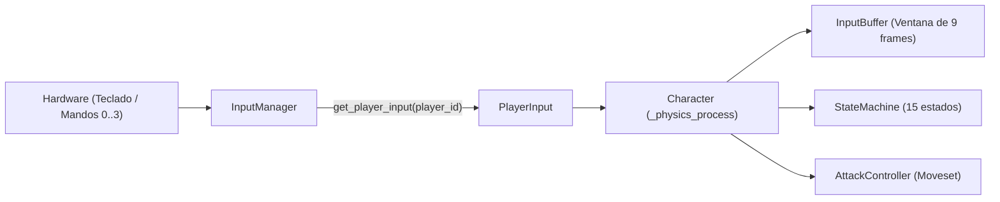

# Explicación de `core/player_input.gd` (DTO de Intenciones)

## Resumen
`PlayerInput` es un **Data Transfer Object (DTO)** ligero (`RefCounted`) que representa las intenciones de control de un jugador durante un frame específico de física.

Aísla por completo la física 2D del personaje (`CharacterBody2D`), los controladores y la máquina de estados (`StateMachine`) del dispositivo físico (teclado, mando Xbox o futura IA).

---

## 📋 Estructura Principal
```gdscript
class_name PlayerInput
extends RefCounted

var movement: Vector2 = Vector2.ZERO  # Stick izquierdo normalizado (X: Izq/Der, Y: Arriba/Abajo)
var c_stick: Vector2 = Vector2.ZERO   # Stick derecho para ataques direccionales inmediatos
var is_dash: bool = false             # Intención de carrera rápida
var jump_pressed: bool = false        # Salto pulsado en este frame
var jump_held: bool = false           # Salto mantenido (define Full Hop vs Short Hop)
var attack_pressed: bool = false      # Botón de ataque normal
var special_pressed: bool = false     # Botón de ataque especial
var shield_pressed: bool = false      # Botón de escudo pulsado en este frame
var shield_held: bool = false         # Botón de escudo mantenido
```

---

## 🔄 Flujo Adapter (`InputManager` → `PlayerInput` → `Character`)


## Beneficios Arquitectónicos
* **Independencia de Hardware**: Remapear botones o cambiar entre teclado y mando en `ProfileManager` no altera ni una línea de la FSM ni de la física.
* **Preparado para IA / Bots**: Un bot solo necesita rellenar un `PlayerInput` sintético cada frame.
